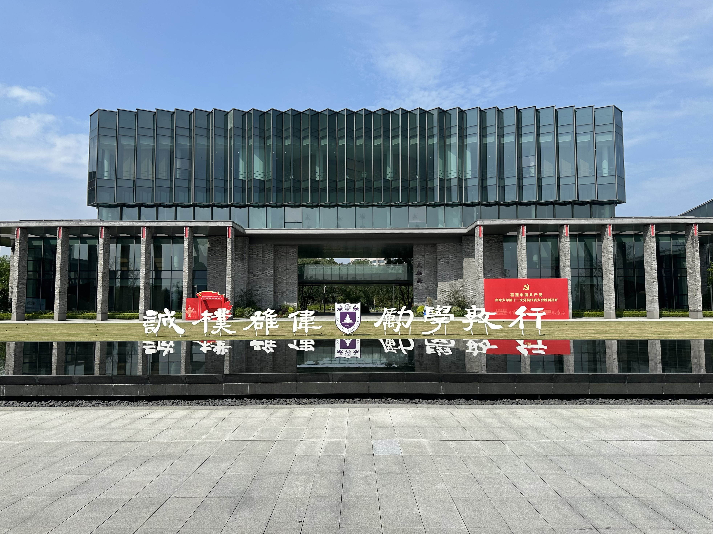

## 目录

- [个人背景](#个人背景)
- [写在前面](#写在前面)
- [夏令营经历](#夏令营经历)
- [预推免经历](#预推免经历)
  - [东南大学计软智](#东南大学计软智)
  - [南京大学智能科学与技术学院](#南京大学智能科学与技术学院)
  - [南京大学智能软件与工程学院](#南京大学智能软件与工程学院)
  - [华东师范大学计算机学院](#华东师范大学计算机学院)
  - [本校本院](#本校本院)
- [最终去向](#最终去向)
- [Call Call Back](#call-call-back)
- [事后烟](#事后烟)

## 个人背景

| 背景 | 情况 |
| --- | --- |
| 本科专业 | 计算机科学与技术 |
| GPA | **3.93 / 4.00** |
| rk | **1 / 141** |
| 英语成绩 | **四级 651，六级 589** |
| 荣誉 | 国家奖学金、智能之星 |
| 科研 | 一篇一作 CCF-C 会议论文 |
| 竞赛 | ICPC 区域赛铜牌、数模国赛国二 |

> 我的夏令营和预推免 bg 完全相同，所以下文中不再进行区分。

联系方式 **QQ** `3485960162` ，**微信**  `13382237027`，请注明来意。感兴趣的朋友欢迎私聊呀！

## 写在前面

>**我的投递倾向：**
>
>从往年去向来看 rk1 去东南应该没有什么问题（笑了真没问题吗），而且我是江苏小孩，江苏小孩对东南的滤镜懂的都懂。所以我的策略是以东南为主，顺带报一下保底院校，主要精力用来冲刺华五。华五之下的学校**不接受直博**，华五学校也是**优先报名硕士**，但是也会综合考量学院平台、培养模式、未来发展空间等因素，如果都很满意且适合自己，会进一步接受直博。

在**大三上学期**，我主要是广泛阅读经验贴，经验贴全部来自**知乎和小红书**两个平台。我主要关注的是**我同层次背景同学的去向**以及**进入我目标院校的同学的背景**，顺便整理了我目标院校的考核方式等信息，做到心中有数的同时，针对个人背景的不足之处做查漏补缺，尽量提升自己的整体背景。

我在**寒假结束返校开学**之后开始套磁，主要套磁华五院校的老师，有些老师可能还会安排一些考核，这些需要快速且高质量的做完，尽早与老师进行下一步的交流。**五一节返校后**我开始联系东南大学等中九的老师（骗你的其实只有东南），但是实践下来发现好像还是有点晚。东南的事情我后续会细说。

至于专业课和机试？那自然是一点没看呀！本来我是雄心壮志决定要平时带着学，结果是一点没看，暑假里每天高强度观看 bilibili 主播**一米八的坤儿**的 pubg 直播，对斗地主有了十分深入的了解（笑）。我临近预推免才着急忙慌临时抱佛脚，学个七七八八就上考场。大家不要学我哦！

## 夏令营经历

今年的保研相较去年又有了很大的变化，其中一个很明显的特征就是**高校大规模的取消夏令营**，或者是只举办宣讲性质的夏令营。在清北华五人这些顶级高校中，仍然举办有考核有效力的夏令营的学校只有**北大、中科大、上交以及人大**，这也导致这些夏令营的入营门槛高的飞起，我一个都没入，喜提一个清闲的七月，所以我就不列表汇总自己的情况了。

这里想再说一下上海交通大学的计算机学院，上交计算机学院就算是直博入营也是**强 com **的，且**入营即优营**，需要**和老师双选合成 offer**。我报名的是 **081200 计算机科学与技术学术学位直博**，但是没入营，但是我看到有 211 的小伙伴在 bg 不如我的情况之下报名了 **083900 网络空间安全学术学位直博**以及 **085400 电子信息专业学位直博**的，都入营了，所以应该是我的投递策略有一些问题。但是从后续来看，上交今年严重缩招，恐怕我入营了也双选不到老师，也就无所谓了。

再提一嘴国智院的事情，国智院的考核一般安排在5月份，我报名了北京的中关村学院以及上海的创智学院，但是都没有入营。不过现在创智收紧了实习政策，中关村学院也不知道未来会如何动作，去年捡漏华五的红利今年显然是吃不到了，想要去国智院的同学也请权衡后再做决定。

所以综上所述，我在今年的夏令营中喜提夏 0 营，对我经历感兴趣的同学可以不用仔细看这一部分，移步预推免篇章吧。

## 预推免经历

在开开心心的躺平一整个七月之后，东南打响了预推免报名第一枪，而随着 8 月 3 号南大开始预推免报名之后，我兵荒马乱的预推免开始了，这短短的一个月体感上却有一年一般漫长。照例还是放一下整体情况：

| 学校 | 院系 | 截止时间 | 是否入营 | 是否优营 | 备注 | 公告链接 |
| :--- | :--- | :--- | :---: | :---: | :--- | :--- |
| 清华大学 | 清深 | 7.28 | ❌ |  | 抽奖 |  |
| 东南大学 | 计软智 | 8.10 | ✅ | ❌ | 排名 111 / 190，最恶心的一集，从此化身东南黑子 | <https://cs.seu.edu.cn/2026/0710/c49342a576431/page.htm> |
| 中山大学 | 计算机学院 | 8.12 | ❌ |  | 高贵的鸭鸭 | <https://cse.sysu.edu.cn/article/3587> |
| 南京大学 | 智能科学与技术学院 | 8.14 | ✅ | ✅ | 最终去向，智科的恩情还不完 | <https://is.nju.edu.cn/d4/5b/c57656a840795/page.htm>         |
| 复旦大学 | 计算与智能创新学院 | 8.17 | ❌ |  | 高贵的旦 | <https://gsao.fudan.edu.cn/fb/0b/c15029a785163/page.htm> |
| 南京大学 | 智能软件与工程学院 | 8.18 | ✅ | ❌ | 二进宫南大，可惜有offer已摆烂，喜提wl | <https://ise.nju.edu.cn/info/1018/3131.htm> |
| 中山大学 | 软件学院 | 8.20 | ✅ | ❌ | 和南大智软撞时间没去 | <https://sse.sysu.edu.cn/article/1088>                       |
| 同济大学 | 计算机学院 | 8.25 | ❌ |  | 好高的bar | <https://cs.tongji.edu.cn/info/1022/4119.htm> |
| 天津大学 | 计算机学院 | 8.27 | ✅ | ❌ | 和南大智软撞时间没去 | <https://yzb.tju.edu.cn/xwzx/tkss_xw/202607/t20260702_324675.htm> |
| 南京理工大学 | 计算机学院 | 9.1 | ✅ | ❌ | 没参加面试 | https://cs.njust.edu.cn/9b/a8/c1754a367528/page.htm |
| 中山大学 | 人工智能学院 | 9.4 | ❌ |  | 甚至没有报名系统 | <https://sai.sysu.edu.cn/article/747> |
| 华东师范大学 | 计算机学院 | 9.5 | ✅ | ❌ | 没套磁硬入，旅游去了，超低位候补 | <https://cs.ecnu.edu.cn/c3/c2/c19867a771010/page.htm> |
| 大连理工大学 | 计算机学院 | 9.7 | ✅ | ❌ | 和华师大cs撞时间没去 | <https://gs.dlut.edu.cn/info/1173/51492.htm> |
| 华东师范大学 | 数据科学与工程学院 | 9.8 | ❌ | | 这为什么没入啊？ | <https://dase.ecnu.edu.cn/c4/1f/c41465a771103/page.htm> |
| 南京航空航天大学 | 人工智能学院 | 9.13 | ✅ | ❌ | 和南大智软撞时间没去 | <https://mp.weixin.qq.com/s/oewIcHhwW2Ql2koyZUDSWQ> |
| 浙江大学 | 软件学院 | 9.10 | ❌ | | 今年浙软卡2卡疯了 | <http://www.cst.zju.edu.cn/2026/0807/c32178a3193932/page.htm> |
| 江南大学 | 人工智能与计算机学院 | 9.17 | ✅ | ✅ | 怕没学上本校保底一下 | <https://yz.jiangnan.edu.cn/info/1012/3864.htm> |

下面根据考试时间顺序介绍一下我参加过的五个预推免吧。

### 东南大学计软智

报名计算机科学与工程学院 085410 人工智能专硕（即计专），考试时间 8.25。

**提前叠甲**：本部分可能会有比较多的情绪化表达，东南大学在计算机领域的实力大家有目共睹，是非常好的学校，而且我联系的老师也是非常好的老师，给了我许多帮助与指导。但是无论是面试老师还是教务人员，接二连三的迷惑操作真的反复让我觉得东南是我考核体验最差的学校。

**前置知识**：东南计软智是三个学院联合办公，在保研的时候，对于申请硕士，**所有的学硕**专业简称“**计学**”，除去软件专硕的其他所有专硕（即**计算机技术专硕**与**人工智能专硕**）简称“**计专**”，计学与计专由**计算机科学与工程学院**招生；**软件专硕**由**软件学院**招生，简称“**软专**”。计学、计专、软专三个赛道各自一起考核一起排名。

我从**五一节返校后**开始套磁东南老师，但是令我感到诡异的是回复率异常的低，不过我还是在五月底联系到了一个 PALM 实验室的老师，通过了面试，老师把我放进了 PALM 实验室考核的免考核名单里，我顺利拿到了 PALM 实验室的 offer。不过面试的时候老师就跟我说今年东南可能会从以前的弱 com **改为强 com**，七月份正式开始预推免报名的时候这个传闻得到了验证。这件事也使得今年我们学校入营东南的人特别少，只有五个人，报名计专的更是只有我一个人入营了，还是非常危险的。

大概 **7.19** 东南发了入营名单，老师也是特别好心的提出帮我们修改 PPT 并让我们试讲一下提一下建议。计专安排在 **7.25** 进行考核，**只有线下面试**，我被安排在上午，流程是一共**十五分钟**，先进行**五分钟的自我介绍**，然后是**英文问答和中文问答**，时间到了会响铃。而让我最觉得恶心的事情就此开始：在我结束了自我介绍和英文问答后，大概还剩八分钟的中文问答时间，一个目测 50 多岁的中年男老师直接一人独占所有提问时间拷打我**根本没写在 PPT 上、仅出现在报名表上**的大创项目。大创我并不是负责人，只负责了一些打杂工作，所以我首先表达我并非项目负责人，没有完成主要的工作，但是那个老师显然也懒得听你说，就一个劲问自己的问题，甚至还问了什么“用了什么显卡训练了多久”这种垃圾问题，出了考场我就知道完蛋了。

面试完心灰意冷，骑电瓶车绕学校参观了一圈顺便去食堂用掉餐券之后，就去新街口找我同学玩了，结果在德基广场狠狠流鼻血，充分利用了一次德基的豪华厕所（雾），真难绷。现在回过头看，从我开始套磁时几乎没人回我到面试完血洒德基，一切似乎都是命运在暗示我与东南无缘，不过真的好命苦呀。

你以为这就完了？我去还有第二关！**九月一号**东南发了成绩排名，意料之内我拿了个很低的排名，但是名单上甚至没有标谁是优营，因为本校的保研去向没有确定，所以一切又只能看运气了，教务也是什么信息都不透露，就让你一个劲干等，这你受得了啊？出成绩排名那天我还在准备智科的考试，看到自己惨淡的成绩是真的非常伤心，难受的一晚上一个字都没看进去，哭哭。

骗你的，抽象事情还没结束，虽然我没有填东南的志愿，但是 924 当天计学光速鸽穿，低位候补的计专可以改报志愿为计学继续录取，我的排名是可以被录取为计学的。这也很离谱呀，这么看反而低位候补还吃上红利了呢，无痛上岸学硕。真受不了了，整个预推免从头到尾要么是**信息不透明**要么就是**混乱无比**，都这个样子了考核体验还会好吗？我只能说祝鸽穿……

### 南京大学智能科学与技术学院

报名 081200 计算机科学与技术直博，考试时间 9.4 ~ 9.5。

从去年和今年两年的情况来看，在南大五个信息类学院中，智科应该是唯一一个**弱 com **的学院，这里详细解释一下：**报名直博**必须要联系好老师、签好导师联系表、获得导师的推荐资格，满足这些条件才能入营；**报名硕士**可以凭自己的背景不套磁硬入，但是更多的人都是联系好老师拿到老师的推荐名额入营的。所以无论是硕士还是直博，只要能**拿到老师的推荐名额**，就一定可以入营。

我是在**四月中旬**联系到的我现在的导师，老师人很好，而且也没有组织考核或者很硬核的面试，只是给我打了两次微信电话跟我交流想法，通过两次交流我充分了解了老师的研究方向、培养模式、未来发展前景等关键信息，发现与我的个人规划高度一致，老师也对我的背景比较满意，于是在**五月份正式确定**报名直博。后来八月份预推免开始报名后，老师又针对我的报名材料询问了我的相关信息和意向，给了我推荐名额，顺利入营。

> 这里要注意的是，智科除了需要在南大的报名平台上报名之外，还需要在自己学院的 **labora 平台**上完成报名，只有两个平台都报名了才算是有效的报名。

这里还想再多提一句，我在高三的时候就一直想考南大苏州的技术科学试验班（智科为其中的分流选项之一），而我高三的平时成绩也远远好于我最后的高考成绩。所以当老师询问我意向的时候，我会非常坚定的说：只要有智科的 offer，无论如何我都会选择智科。

在九月一号得知东南噩耗之后，我也来不及悲伤了，智科是我背水一战的机会，这次不能再失败了。9.3 到达南大苏州校区报到，交材料领号码牌，下午去跟导师线下见面，导师提出等五号预推免考完了请所有报名他的课题组的入营同学吃个饭，真好啊老师！跟老师聊完之后再去找江大保研到南苏的学长吃饭，倒也没那么紧张了。晚上出来了考核安排，最终数据为：硕士 295 人入营实际参营 195 人，发 60 多个 offer，最终候补到大概 80 多名的位置；直博 95 人入营实际参营 77 人，发 50 多个 offer，最终候补到 60 多名的位置。所以竞争压力真的不小，硕士更是腥风血雨。**硕士与直博的考核内容完全相同，只是分开排名而已。**

**9.4 上午**是笔试，考察**机器学习、数据结构与算法、离散数学、人工智能导论**，考的题目不难但是范围很广，需要全面的复习。**下午**是机试，整体难度很简单，**前两题强制使用 C++，后两题强制使用 Python**，所以需要两种语言都比较熟练，我就是吃了 Python 不熟练的亏，只做出来三道题。机试可以实时查看分数与排名，AK 的人很多，不过其中明显硕士人数大于直博，这也再次说明硕士赛道的竞争压力是大于直博的。至于具体考了什么类型的题吗，我签了保密协议的，所以不能在网络公共空间讲。**如果你真的很想考智科的话，欢迎加联系方式私聊，主播自认为对智科的各个课题组了解是比较充分的，可无偿辅导捏。**

**9.5 全天**都是面试，面试流程与东南相似，流程为**自我介绍、思政考核、英文问答、中文问答**，其中自我介绍要求**双盲，不提及自己的姓名即可**，面试可打印**不超过五张**个人简历分发给面试老师，简历要求**遮去自己的姓名即可**。不得不说智科面试的体验真的比东南好太多了（~~苦也，这还言车~~），老师的提问完全贴合简历，而且态度非常友好，特别是主考官一直笑眯眯的，说话也很温和，让我极大缓解了紧张情绪，出了考场之后感觉非常好。只要对简历上的内容充分了解，面试就不会有什么问题。我是上午面试的，下午就在南雍楼找了个空教室自习，晚上是导师请吃饭，是木渎的一家贵州地摊火锅，真的非常美味啊，可惜由于自己有点焦虑于预推免，所以没怎么吃好。后来跟别人聊天听说这家店是我导师的固定据点，哈哈哈哈哈，看出来他真的很喜欢这家店了。

**9.7** 是学校的开学日，那会我还没有任何 offer，焦虑的要炸了，所以回学校上课的同时顺便提交一下本校预推免材料吧，是真的怕没学上。下午上完课回家实在没事干就睡觉了，睡到大概四点多钟突然觉得有什么大事要发生就醒了，一看智科聊天群里面有人说晚上就会发 offer，遂困意全无开始私聊询问情况，煎熬了两个小时，首先是硕士开始发 offer 邮件，直博后发，听到硕士开始发的时候也是紧张的没边了。最终在 18:04 的时候智科发来了邮件，**获得offer！**我从床上一跃而起，就这样上岸了，结束了长达半年的保研历程。不得不说智科教务动作真的很快，才结束两天就发邮件了。

其实智科的经历让我事后有了很多碎碎念，干脆就在这边来点事后烟环节吧。非常喜欢 CS 解说**玩机器 Machine** 在解说 2026 科隆 major 总决赛时候对传奇老将 niko 的评价“如果上天赐予你一把斩断过去的剑呢”，**命运会一遍一遍给你出同一道题，直到你给出正确的答案**，从高三到大三，我无数次向往南大智科，也与智科逐渐产生了紧密的关系，当保研预推免来临，斩断过去的剑就握在自己手里。Maybe not today, maybe not tomorrow, maybe not next month, but one day, I will realize my dream.

回到上岸智科的全流程，我最大的感觉就是**拼尽全力不如命运轻轻一笔**，除去我的个人背景以及个人能力等因素，我认为运气在这个过程中同样占比很大。我的运气真的特别好，碰到了很好的导师，碰到了很好的面试老师，笔试机试也都不难。再说远一点，如果我当时真的高考没爆炸去了智科，那我还能拿到保研名额吗？都很难说吧。我在东南的考核过程中状况百出，但是南大智科的考核却无比顺利，考完后也只觉得心情平静，也许冥冥之中命运已经为我安排好了去处。

### 南京大学智能软件与工程学院

报名 085405 软件工程专硕，考试时间 9.12 ~ 9.13。

这个时候我其实已经结束保研了，所以去智软考试完完全全只是想再去南大苏州校区玩一玩，顺便熟悉一下未来的学校。智软一共入营了 118 个人，我们学校入了三个，不过从第一天开始就发现好多人都没来啊，还有些是机试过后决定不参加面试的，所以实际参加考核了的人会少不少。这件事也告诉我们无论如何一定要争取**完整做完所有考核流程**，这样其实已经赢了一半了。

第一天上午是报到和机试，机试有三个题，明显比智科的难，我做出来第一题之后就没怎么看第二题和第三题了，本来也就是来玩玩的。不过好评的是智软竟然送了 40 元的餐券还有一件文化衫，智科你为啥没有！我直接去十六食堂猛猛消费，牛杂面非常美味！

下午在南雍楼辗转多个空教室自习，我呆过的几个空教室接连因为挂科补考、研究生补课、学生会活动而被占用，好不容易找到空教室自习到吃晚饭。晚饭结束后是一个导师见面会，智软的老师非常少，所以课题组也比较少，不过智软的课题组做的方向都比较杂，研究方向这块感觉不如智科。

第二天全天都是面试，我被安排在下午面试，甚至是最后一个，但是有很多人都没来参加面试，所以两点多钟的时候就轮到我进去面试了。智软的面试也和智科不太一样，是直接抽题的，涉及**思政考核、英语文献翻译以及项目提问**，无论如何还是拼尽全力的回答完了，体感不是很好。有一个很好玩的事情，就是抽题的 PPT 上竟然写的是“南京大学软件学院”，结合一些智软要搬回南京的传言，一切是不是都合理起来了呢？

智软教务的动作也非常快，同样是**结束考核仅两天**，9.15 就发 offer 了，估计是我面试表现不太好没拿到，候补了。不过 9.22 确认复试当天下午智软教务打电话来询问我意向，估计是能补到我，但是我早已决定效忠智科，便放弃了智软。智软教务颇有风度跟我说“非常恭喜，我们苏州见！”。啊呀，南大的人文关怀，无需多言好吧！

### 华东师范大学计算机学院

报名 085404 计算机技术专硕，考试时间 9.16 ~ 9.17。

这个更是摆大烂，其实最早是根本没想来参加的，只是之前跟一个以前的同学说好了要来上海找人家玩，所以还是决定来旅游。这次考试的地方在华师大的普陀校区，普陀校区地处内环，是一个非常美丽的校园，有很多极具特色的建筑，进校门之后我拿起手机就是一顿拍照。

第一天下午是报到和机试，机试一共四个题，明显比南大的机试要难。然而我这次是真的摆，总共 300 分我一共就拿了 55 分就开始睡觉，机试一结束就赶紧拎包走人坐地铁去找我同学玩了。这里给大家推荐一下 **CP 静安的豆库**，真的是特别好吃的一家漂亮饭啊，又出片又美味！吃完饭在静安嘉里中心转了一圈直接转场去西岸梦中心，一边喝奶茶一边在黄浦江边吹风，和同学海阔天空的聊天，松弛感这一块。但是我依旧奇怪为什么我还没有收到第二天面试的安排呢，直到回到酒店我灵光一闪打开了邮箱的垃圾邮件分区……

第二天我被安排在下午面试，面试更是梦到哪句说哪句了。华师大的面试非常正经，自我介绍结束后就是抽题作答，包含**文献朗读与翻译、专业课、思维题、项目提问**，文献朗读非常顺利但是我翻译的很不顺利，专业课考了一个 **`new/delete` 与 `free/malloc` 的区别**、考了一个**全局最优解和局部最优解的区别**，其他的记不起来了，思维题是一个算 24 点，我也没想出来。专业课我根本没复习，就完全凭借残存的记忆回答，也是回答的一坨。项目提问的最后，一个老师非常尖锐的提问我为什么机试分数那么低，我早知道有这一环，直接乱扯一个理由搪塞了。在面试结束之前，有一个老师问我联系了哪个老师入营，不过我其实根本没联系过老师，我就如实回答了，感觉那个老师还有一点诧异。后来加了一个华师大本校的同学，才从她那边知道原来华师大计算机学院是**弱 com**，要联系老师的，那我没联系老师直接凭 bg 硬入了，也是十分神奇。

语言是苍白无力的，文字远不能描述我面试的混乱，最终我还是草草结束了这如同闹剧一般的面试，迅速坐地铁去火车站买票回家，估计面试老师都要被我的糟糕表现气笑了。华师大的教务更是十分迅速，一天之后就公布了成绩排名，果不其然我喜提倒数，填志愿当天我就没有填华师大了。

### 本校本院

报名 081200 计算机科学与技术学硕，面试时间 9.20。

我在本学期开学（9 月 7 号）之前一直没有铁 offer，所以怕没有学上还是在开学第一天提交了本校本院的报名信息。理论上**需要联系老师推荐**才能入营，但是应该因为我是本校的吧直接就让我入了。本院的预推免只有面试，而且是**线上**。一分钟自我介绍结束之后老师问我有没有参加别的学校预推免、有没有获得 offer，面试的那会我已经有 offer 了，就如实回答了，老师就匆匆结束了面试。后续顺利拿下优营，不过没有填报志愿。

## 最终去向

- 最终去向：南京大学智能科学与技术学院计算机科学与技术直博
- 选择原因：这是我唯一的 offer，好钢就要用在刀刃上！

## Call Call Back

有道是“苦难是文学的温床”，诚哉斯言！回过头看，我竟然已经一口气写下了这么长的经验贴！

保研是一个相当艰难的过程，特别是对于我们 211 鼠鼠，其中艰辛更是只有亲身体会了才能知道。我从三月开始准备保研，直到九月初都几乎完全没有正反馈，暑假里因为一个夏令营都没入也是非常心灰意冷，几乎没复习专业课也没复健机试，天天就高强度刷B站和抖音了。

我应该算是我们学院去向最好的几个同学之一了，但是我绝对不会告诉你我经历过的那些迷茫、焦虑、失望甚至失声痛哭的深夜。如今回想 9.7 那天依旧觉得有一种强烈的不真实感，才结束南大智科预推免两天我就收到了 offer 结束了保研。也许南大对我的考验不是那些机试笔试面试，而是我能不能在东南坠机之后快速调整心态准备下一场考试，看来我给出了一个优秀的答案。

**N**ew **J**ourney **U**nfolds. 从 JNU 到 NJU，我用了三年时间寻找这个逆序对，夏末微风吹干了十八岁少年的泪痕，高考的遗憾在这一刻终于得到弥补。就像 ACM 俱乐部一个学长曾经对我说的：永远要记得向前看，别烂在过去和梦里。

## 事后烟

虽然我都是临时速成的专业课和机试，但是我还是推荐大家要平时带着练，命运只会垂青有准备的人。详尽的复习建议早点开始，因为期末周很忙没时间，或者期末周之后的暑假集中复习。

**机试**的复习我推荐使用 LeetCode 和 AtCoder，有什么不会的算法就去查阅 oiwiki。预推免机试的题型与 LeetCode 重合度很高，但是基本都是需要标准输入输出的，所以还是应该要会对这些东西进行处理。许久不练的 ACMer 也要记得及时复健，不要像我一样考场上连并查集都能敲错。

**面试**需要对自己简历上的内容完全掌握，特别是自己主导的科研项目和竞赛项目，我这里有一个辅助方法，就是让 GPT 去阅读你的论文和代码，对项目从动机到具体方法进行深入的分析与总结。**英语问题**的话每个项目都准备两到三分钟的**项目介绍**和**创新点阐述**，加上一些日常问题即可。总有可能会被问到一些没准备的问题，这个时候不要被老师牵着鼻子走，要锻炼自己的临场发挥能力，**由自己主导整场面试**。

保研是一场信息战，推荐大家 GitHub 搜索 csbaoyan，或者加入计算机保研交流群（绿群）943826679。大家一起水群聊天，也会有很多很有用的信息，9.24 那天绿群还一直在放一路生花哈哈哈哈。小红书上也有很多信息，不过小红书上贩卖焦虑很严重，建议屏蔽所有保研辅导账号。

保研期间一定要保持良好的心态。网上或者身边看到别人的背景比自己好或者拿到 offer 自然会焦虑或者羡慕，但是每个人都有自己的节奏，只要保持端正的态度，方向清晰、节奏稳定、策略合理，就一定能够走到适合自己的位置上。把每个阶段的事情都做好，结果就不会太差。不要给保研附加太多的价值，保研只是很多升学路径中的一条，以平常心对待即可。

最后给我们 PRLab 打个广告，欢迎大家加入进来，做更多有意思的研究。**N**ow **J**oin **U**s！

