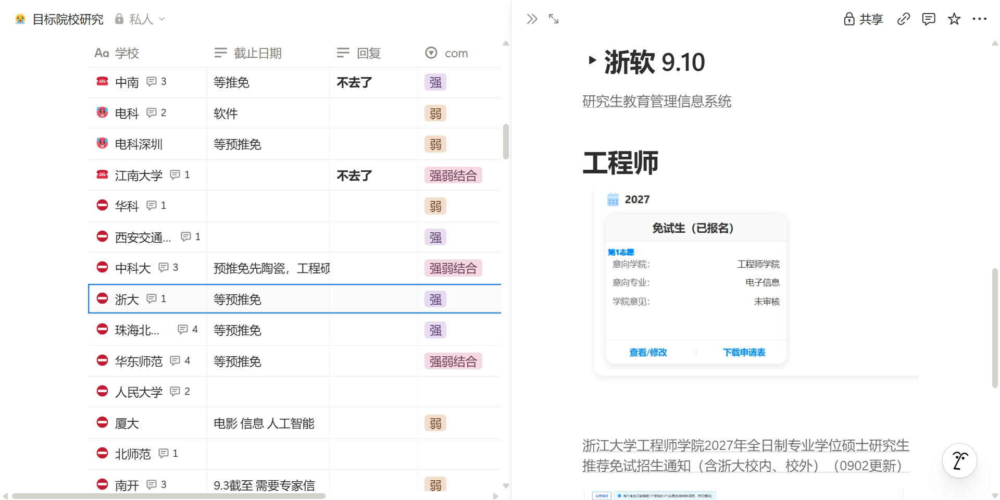
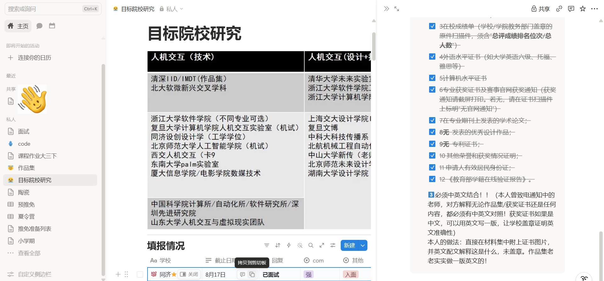
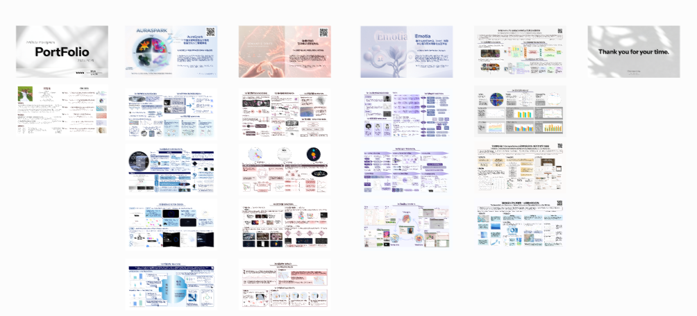
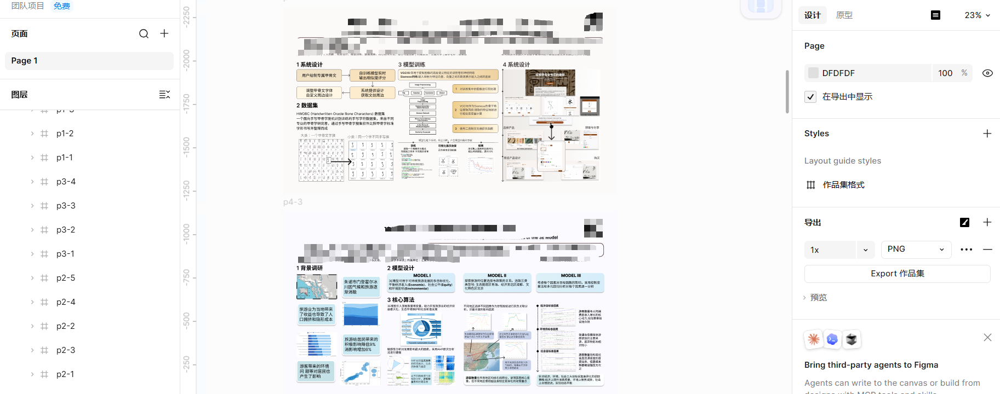
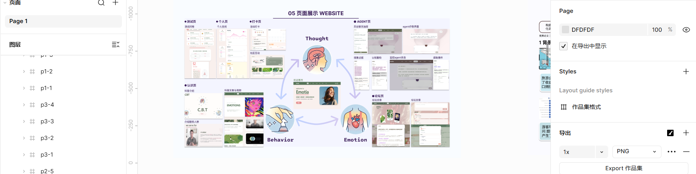
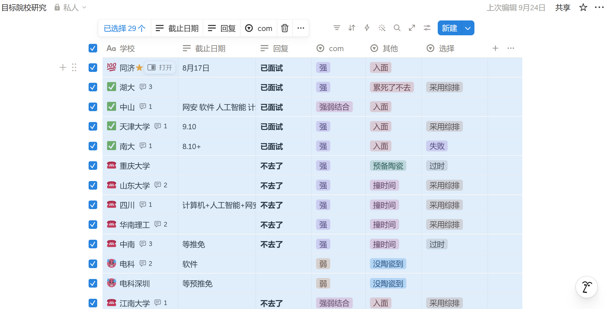
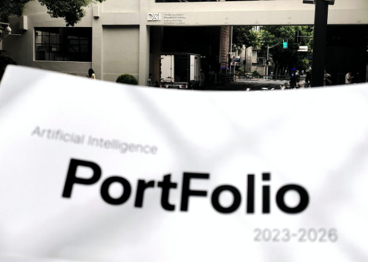
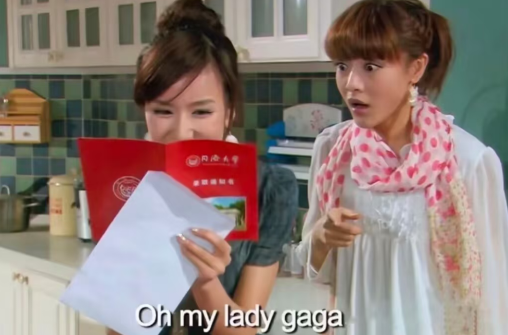

---
# 必填：请替换为你的文章标题、署名和申请年份。
title: "labyrinth的保研经历"
author: "labyrinth" # 必填：换成你的英文昵称，仅大小写英文字母、数字或连字符；须与文件夹名完全相同，包括大小写
applicationYear: 2026 # 必填：当前新稿为 2026，须与年份目录一致

# 封面：文件放在 index.md 同目录，名称与扩展名须对应；省略时使用项目图片池。
# 用于卡片及文章页顶部，不会自动插入正文，也不会从正文插图中自动选取。
cover: "./cover.png"

# 以下均为选填。需要时删除对应行开头的 # 并替换示例；不填写时保留注释或删除。
undergraduateMajor: "人工智能"

# 涉及院校：只用全称填写申请表或单独院校章节中的学校，未入营/放弃/未参加也可收录。
# 仅在问答、补充、多校投递回顾或一般建议中提到的不加标签；没有符合条件的院校可省略。
# 同校不同学院合并，明确的校区/研究院保留区别，不推测未注明的院所。
institutions:
   - "同济大学"
   - "湖南大学"
   - "中山大学"
   - "天津大学"
   - "南京大学"
   - "中南大学"
   - "华南理工大学"
   - "四川大学"
   - "山东大学"
   - "重庆大学"
   - "华中科技大学"   
   - "北京理工大学"

# 原始出处：已有公开原文时填写完整 URL；首次投稿可省略。
# sourceUrl: "https://example.com/my-experience"

# 最终去向：按实际情况填写，将显示在文章页；与涉及院校分别记录。
finalDestination: "同济大学"

---

<!--
请将本文件保存为 index.md，与封面及正文插图放在同一文件夹。
当前 PR 路径：src/content/experiences/2026/<author>/index.md。
例如 author: "xiaojiang" 对应 2026/xiaojiang/index.md，文件夹名直接复制 author。
可使用 GitHub 用户名；匿名也可自选英文昵称，无需填写真实姓名。
同一年内昵称不能与已有文章文件夹重名，也不能仅靠大小写区分；如重名，请同时修改 author 和文件夹名。
正文图片用  引用同目录文件，不要写电脑上的绝对路径。

模板仅供参考，不要求完全按照示例撰写。可按自己的经历调整标题、章节、表格和写作顺序。
YAML 中的 title、author、applicationYear 必须填写；author 与文件夹名、applicationYear 与年份目录必须一致。
一位投稿者提交一篇完整经验贴，夏令营和预推免可在同一篇文章中分章节记录，不需要拆成两篇文章。
无需手写目录，网站会根据正文标题自动生成左侧目录。
收录时间由网站从 Git 历史自动读取，无需填写日期。

这些 HTML 注释是填写提示，网页正文不会显示，可以保留，也可以删除。
需要填写或删除的是未完成的正文占位、示例表格行和不适用的章节。
若要展示注释中的图片示例，请去掉包裹图片语句的注释标记，并替换文件名和说明。
-->

## 个人背景

<!-- 参考原模板，只填写你愿意公开的信息；不适用的行可以删除，也可以增加项目。 -->
我有分两个阶段的投递，一个是没出综合排名的**10%**（6%-10%都算这个阶段），以及提升之后的**3%**（1%-3%都算这个阶段） 
| 项目 | 内容 |
| --- | --- |
| 本科专业 | 人工智能 |
| GPA | 3.73 |
| rk | 6%->2% |
| 英语成绩 | 四六级500+ |
| 荣誉 |  一些奖学金（没用到过） |
| 科研 | 3C（2一作） |
| 竞赛 | 美赛F 蓝桥杯国三 数媒国二 |

联系方式： zzhx_2004 **（wx）**、2024126101 **（qq）**
如有需要请礼貌联系
## 关于我如何准备保研
### 细节
先说准备过程中小细节吧，给大家安利这个是notion，我拿来记录不同学校系统的账号密码和面试陶瓷情况，方便更新查找，查缺补漏。

### 三年准备经历
所有方向都是有共同点吧，大家也可以参考我的路径准备自己方向
| 阶段 | 内容 |备注|
| --- | --- | --- |
| 大一~大二上| 不断参加比赛积累经验 | 我觉得这个阶段打比赛蛮重要，虽然比赛在最后保研没有很多老师问，但是比赛的过程对我来说是一种成长，我大一就开始带队打比赛，锻炼我的技能，能让我后面有时间进一步成长，而不是从头开始学 |
| 大二下 | 搜集信息差，准备保研论文，研究该方向有什么学校，该如何入门，在这个阶段还是一知半解，但是已经有一定认知：交叉方向要有对应经历，不用很复杂，但一定要有，显示出自己有研究过；AI专业本身很占优势，需要发挥自己优势；善于利用本校优势，可以和本校强势学科合作 |途径来源于学长学姐分享+xhs+论文，其实主播这个时候就已经看上同济|
| 大三上 | 确定目标逐个击破：和设计学院同学合作产出hci论文ing，持续产出自己的ai论文ing，参加设计相关比赛ing|这个阶段要平衡课业，我是少选了课后面大四上（为了不会太忙导致成绩下降）|
| 大三下 | 论文成功发表，比赛拿到结果，此时结合同学院学姐经历确定自己最有可能的目标学校--同济，开始针对性准备梦校。由于hci需要作品集，主播这个时间一直在打磨作品集（在面试的时候老师非常惊讶我学ai的作品集也能做这么好，还问我是不是花钱了，但其实耗费0r） |在论文有结果之后这个阶段可以陶瓷，这个阶段会很忙，主播本人也是八爪鱼，既要拿到全满绩，也要比cs同学多准备作品集，还得陶瓷和资料收集一条龙|

### 面试技巧
怎么准备面试问答我有一点技巧可以分享一下，反正我按照这个模板战无不胜，没被问倒过。
按照这个拆分项目：
> 你负责哪部分、遇到了什么困难、怎么解决的、最后结果如何
>> 拆分：项目背景：看到xx现象，xx问题，产生xx兴趣（为什么要做这个项目，解决什么问题）、角色介绍（负责了什么）、具体负责工作：为什么用xx，（用了什么，遇到什么困难如何解决）贡献度（项目最后产出）反思与收获

> 面试还需要准备反问老师的问题，以及对老师方向的理解（豆包快速浏览）以及为什么要选择这个方向。

> 专业课我只有在南软准备过，背了很多408没用上，后面也没有背过，也没人考过，不算准备重点，想准备就准备吧。
### 作品集
单独分享作品集制作经历，不喜欢的可跳过。

工具：figma
前提准备： 确定色调（我选的蓝粉紫，学姐的建议是最好不要黑色），确定做几个项目（我是三大二小），确定尺寸，确定边距等待细节。在小红书找figma教程就行，很方便。

步骤：
1. 随便网上找模板，先确定这个页面画法 
2. 拆分选好的项目，按照**项目背景--调查研究（用户调研/专业知识调研--项目解决的目标问题--项目内容（按照自己做的逻辑拆分，随意设计，可以包括：技术设计/页面设计/功能设计/交互设计，等等做的时候有自己的逻辑）**
3. 通过ai拆分项目一一填入，字数不能太多，不是做ppt需要图文并茂，有自己的思考，加入图片需要考虑色调进行调色，使得整体和谐即可
4. 我的作品例子：

## 夏令营经历

<!--
可在表格汇总各院校的夏令营经历，再在下方补充详细内容。
院校请填写全称；入营情况可用 ✅（&#x2705;）表示入营，❌（&#x274c;）表示未入营。
未报名、放弃或未参加等情况可直接写文字；入营不代表录取，考核结果按实际情况填写。
参考材料可写材料名称或 Markdown 链接，没有时写“—”。
按需要增删表格行及下方三级标题，无需维护表格到正文的跳转链接。
没有夏令营经历时，可以删除整个章节。
-->
没啥学校开夏令营，懒得报名本人颗粒无收，这个阶段在打磨简历，陶瓷和准备面试
| 院校 | 入营情况 | 考核结果 | 补充 |
| --- | --- | --- | --- |
| 中山大学cs | &#x2705; | 无效 | — |
| 同济大学cs | &#x2705; | 无效 | — |
| 中南大学cs | &#x2705; | 无效 | — |
| 哈尔滨工业大学苏州 | &#x274c; | — | 卡9吧我估摸着 |
| 中科大科学岛第三批 | &#x274c; | — | — |

## 预推免经历

<!--
可在表格汇总各院校的预推免经历，再在下方补充详细内容。
院校请填写全称；入面情况可用 ✅（&#x2705;）表示入面，❌（&#x274c;）表示未入面。
未报名、放弃或未参加等情况可直接写文字；入面不代表录取，不要将候补写成正式录取。
参考材料可写材料名称或 Markdown 链接，没有时写“—”。
按需要增删表格行及下方三级标题，无需维护表格到正文的跳转链接。
没有预推免经历时，可以删除整个章节。
-->

**下面是本人预推免战绩，前前后后报了快30个预推免**
| 院校 | 入面情况 | 报名时gpa | 补充 |方向|
| --- | --- | --- | --- | --- |
| 同济大学 | &#x2705; | 6% | 强com |人工智能与数据设计学硕|
| 中山大学 | &#x2705; | 6% | 强com |交互设计专硕|
| 湖南大学 | &#x2705; | 2% | 强com |设设计学学硕|
| 天津大学 | &#x2705; | 6% | 强com |电子信息专硕|
| 南京大学 | &#x2705; | 6% | 强com |软件专硕|
| 重庆大学 | &#x2705; | 6% | 强com |软件专硕|
| 山东大学 | &#x2705; | 2% | 强com |计算机+人工智能+网安 专硕 |
| 四川大学 | &#x2705; | 2% | 强com |计算机+人工智能 专硕 ||
| 华南理工大学 | &#x2705; | 2% | 强com |计算机专硕|
| 中南大学 | &#x2705; | 6% | 强com |计算机专硕|
| 华中科技大学 | &#x274c; | 2% | 强弱结合 |aia专硕|
| 西安交通大学 | &#x274c; | 2% | 不知道com（挠头 |软件专硕|
| 中国科技大学科学岛 | &#x274c; | 6% | 忘记了 |工程硕（小鹏）|
| 浙江大学工程师 | &#x274c; | 2% | 强com |很偏门|
| 北理珠  | &#x274c; | 2% | 强com |计算机技术|
| 华东师范  | &#x274c; | 6% | 不知com |智能交互|
| 人民大学高瓴 | &#x274c; | 2% | bar高 |工程硕|
| 南开大学 | &#x274c; | 6% | 据说有点强弱结合 |软件专硕|
| 东南大学 | &#x274c; | 6% | 强com |软专|
| 中国科学院大学空天院 | &#x274c; | 6% | 随手一投 |忘记了|
| 复旦大学未来信息 | &#x274c; | 6% | 强com |电子信息专硕？应该是|

这边可以稍微参考看看我的信息收集，这样看着不烧心:

### 南京大学软件学院专硕 9月初

<!-- 将“院校一”替换为院校全称，可写报名、材料准备、联系导师、面试或机试、结果和感受。 -->
可以同时报名两个，报了智软和南软（实际上2选1，入了一个另一个不让入，这个要自己抉择）个人感觉最终录取难度上智软>南软，因为南软去了400人录取100+吧，往届有保研成功去智软。这个学院我们学校入了很多，机试强的很有优势，可惜本人机试一般。

面试做Agent项目，双盲形势，不要自我介绍全程拷打项目细节，问题也是ppt抽的，流程包括：英语+项目+专业课+思政+个人亮点。

英语没问问题，就背一分钟介绍。项目抽到的问题是问了开发核心，为什么要这样做。主播讲的很细节包括历史记录上限是几条如何存储如何压缩如何循环都讲了（可能是压力面吧，结束后感觉到的）问我为什么要加入机制巴拉巴拉夹杂我没听懂的名词然后说这是多此一举，没用处什么的，主播没没管不认识的词，就直接回答我设计原委（问题在我意料之内）。这个只抽一题，老师根据这个追问四五个问题然后结束。
专业课准备半天打印15大洋一块钱没用到（不许带电子产品候考），第一题首先问我数据库题目，没学过直接叫他换一题；第二题问我黑盒实验白盒实验是什么（正中下怀，洋洋洒洒回答一大堆）；第三题给了个代码问我代码对吗且答案是什么。然后是思政随便答的，没人看我，我说的也是很尴尬hhh。然后是介绍个人亮点，说了自己比赛和论文，这个环节不能过多介绍论文和比赛干了什么，说多了会被制止，因为双盲。这个时候感受到面试官好像一个唱红脸一个唱白脸，因为我说自己的论文的时候被嘲笑了，他发出哼哼的声音，但是那个情况下没空搭理那个老师的情绪了，我忙着推销我自己

### 中山大学 9月14日

这边主播虐恋来着，你南方人就喜欢回去，中山的title在我心里很高。于是投了四个学院只有一个随手投递的入了

#### 计算机
我知道bar高卡rank1但是主播看见今年要做视频猜测会不会有人懒蛋不想做让我捡便宜，实际证明没有便宜可以捡漏
#### 软件
报名截止前一天这个时候因为东南出结果，炸了很多排在我前面的人，而这个学院报名没有截止，我估计被卡了
#### 网安（深圳）
bar忽然提高啊今年，受不了这个cs风向一年一变，说好的弱com且双非多，结果还是看bg筛选，有陶瓷也没入的也有没陶也入了（好想重生高考考一个末9，92之间感觉有隔离）。主播套到老师了，这里好老师蛮多的，但是毕业要求高且有部分老师不许实习，我问了我陶瓷的老师说酌情放实习。因为感觉bar高了本以为会被鸽，但是今年这个情况会发现其实报名的人还是太多了，921还有很多人眼巴巴等着，鸽子没多少
#### 新传
新传这个交互设计专硕纯纯就业向，报名也没要求作品集我记得。优点就是：毕业容易+放养实习+广州+只读两年，考虑到还不错主播就去面试了。

面试侃侃而谈，反正都回答成功了问了一大堆我根本没准备过：人机交互当下的危机，如何从技术层面解决（这个问题我一直重复回答一直没说对老师也没说啥），然后就是项目具体内容，以及具身智能机器人相关的问题（当时不了解这方面内容依靠南大的项目回答了，因为具身智能底层逻辑就是能够外感知外部世界的Agent。走的每一步都作数！）

英语拷打了一堆：问的太多不记得了起码十个！包括平时用什么ai，各自特点，为什么用这个，最经常用哪个，未来就业还是深造，就业想去什么公司，介绍自己ai经历等等等等。急哭了想说拼音，那些词在脑子里乱转中，准备过八百遍的中文问题结果被英语问出来了。
回答过程老师满意，但是结果情商感人，说自己入了一大堆，还说了同济。于是老师说同济比中山好，那么我们俩同时发offer你去哪，当时特别傻，老师说要真诚的说我就真诚了一波，我说同济，果不其然大家都笑了。

*阴差阳错的和高中同学在同一时间面试，实在有缘，他本校生于是就吃了一顿中山食堂，柠檬水好喝哇咔咔，感觉中山这个校区有点泥泞啊。这里有个小插曲，当天我住在中山对面的酒店退房在纠结怎么去天津，穷鬼纠结半天打算绿皮，然后提早出发了，在火车上收到同学信息说我住的那个地方发生持刀砍人事件，还好我当时提前离开了!!*

### 天津大学 9月16日 

投的新媒体学院的电子信息专硕，我估计也是智算学部。这个天津大学很玄学，我们学校bg高的投cs和软件不给入，但是其实cs学院的老师在新媒体这也收学生，算是一个小技巧吧。可以陶瓷心仪老师问问新媒体有没有名额然后报名新媒体更容易上岸。这个推荐投递但是我这样一说我怕很多人投了但是最后不去，学弟学妹们可以商量着分流投递。因为我看入面双非比较多，且30多号人我们学校就有2个入了，概率还是很大的，最后收10个，只有一个鸽子。

推免阶段去了两个tju，这是其中一个（你终究不是我的tju啊）其实到了这里就后悔了，我南方人不喜欢这么北方的地方，回家很不方便，打车我都听不懂司机师傅在说啥哈哈哈（对不起我一直把这种当做东北口音）。校区很肃穆，机房黑白灰搭配的特别高级有一整栋机房。

早上机试，比较简单的题目，可以看见通过率。下午面试，随机顺序我比较早，流程：英语介绍ai的认识+ppt介绍一波+论文拷打+介绍transform（正中下怀巴拉巴拉顺便把vit也说了）不到五分钟结束了感觉，很随意应该是没看上我（我和学校两两没看对眼属于是）

### 湖南大学 9月18日 
很纠结去不去湖南大学，因为19是同济怕影响梦校考核，但是湖大给主播安排了第一个面试，这下有一定的空挡可以回上海，本着拼尽全力于是坐飞机去长沙了。没咋睡觉，特地喝了两大杯在长沙才能买到的茶颜悦色（其实很喜欢这个城市，感觉很好吃，交通也很方便）

湖大对作品集要求高一点点，需要提前发到图钉网受公众监督。因为湖大设计学本身实力强劲就业大厂多也是很多人竞争的（主播了解之后发现学院的设计方向特别广，包括一些硬件研究）

下午面试，这个不是很严肃，没有志愿者要自己上门蹲着，还好我是第一个。也不是准时开始，老师们慢慢悠悠的，我进去之后还在给电脑充电。英语面试，我其实没听懂问题只听见几个词，就随机回答，很简短但是也没啥问题（就这样胆大糊弄）。面试过程问了特别多项目，这个不说了因为项目我都能对付，老师们对我还挺感兴趣的，并且对我作品集表示喜爱。

还问我对他们学院的了解，这个特别惊险，我一开始没打算来于是没了解过，但是我偶然想起看过一个湖大设计公众号讲的是具身智能的，于是又开始大胆的瞎掰了，因为有中山经历，我不会再傻白甜的真诚了。。我坚决不露怯，时刻自信。在我讲完具身智能这个瞎掰的东西之后老师居然追问了，又是很惊险，但是命运让我和一个搞具身智能保研er的一起聊过，于是依靠着和她的聊天的理解又成功糊弄过去了，老师没再追问。。。我简直头脑风暴。

### 同济 9.18
校园特别美啊，在市中心交通方便，建筑风格也是美哉（梦校滤镜）地点在新大楼，空无一人，全是黑白灰色调，嗲院很高级。

早上八点笔试+英语笔试，入了20个，鸽了七个（和浙大撞了）。笔试是快题（重点在ai+人调度方面的底层设计），英语是aigc相关，特别多写的手都断了。
面试给我抽到第一个了，下午一点半立刻开始了，没咋准备直接上，英语面试居然是外教，心慌了，感觉对面英语太好了我有点没听懂，感觉面试官可能不太满意这也是我估计没有当天晚上直接拿到offer的痛点。

专业面试是直接在小板凳上所有人依次发问，问的特别多，全程停不下来嘴那种，可能有20 min。太紧张了没有表达自己对同济的喜爱特别悔恨，明明前一天还在和同济老师说自己最后一定会来，到了面试就忘记了受不了自己了。。。有保密协议不说很多细节了，感兴趣的同学私信我吧。

我能感受到可能这个和我之前面试的感受不一样，不知道是因为梦校所以对自己压力大，还是确实回的很烂，感到焦虑的原因就是这个学院老师会追问你未来规划细节，包括读研方向的选择，就业岗位选择，包括实习（这个我确实是知识盲区了）感觉答得不是很稳妥吧。在这我感觉和我之前打听到的不一样，来之前我以为老师会喜欢我这种技术背景的，没想到好像一般般，但是陶瓷的时候收到的回应很积极。

不管咋说，过程艰辛但是结果是好的，成功在921复试通知发布那天拿到大结果了，一直在点开系统反复确认，确认这是不是真实的。接到电话的时候追着老师说我愿意，老师都笑了，然后开开心心的去吃喝玩乐了。

### 没入的学校（失败经验）
我这里说一些我没入但是有经验的学校，喜欢这些学校的可以参考参考：
> 华科aia :rank1-3的同学报名（趁早），其他人没机会，华科其他学院应该差不多，弱com但是人家不收211低rank，弱中带强。aia是要陶瓷的，然后我套到了，反正没入跟大家讲一下他们咋收的，拉了个表格然后按照表格一个个加分，类似综测（院校层次，rank，abc不同等级比赛加分不一样，三好学生/志愿者这种荣誉，专利什么的，c会不加分）录取应该纯看加分，这个是线上面试。

> 电科：有点难套，没人回过我，喜欢的早点陶瓷，他们七月多就优选了，问了小红书的说就算有鸽子也是从优选里挑剩下的，后期还想去那得是优选的鸽子全都飞了才有可能。

> 北理工珠海：玄学的学校，去年我报的计算机技术鸽穿了还开了第二批。今年卡我，我估计是报名太多人了，报名人工智能的反而去了很多。大家看情况博弈一下。

> 南开软件：弱com但是我一开始没想过去，忘了陶瓷，听说本校多，老师的主页甚至也说自己往年收本校生多hhh，喜欢的早点陶瓷

> 东南：被背刺了，喜欢的同学可以报网安，计软智不知道咋了

> 清华深圳：这个方向可以报俩iid和imdt，但是今年来也是bar好高，特别是后者搞游戏的，对作品集垂直要求很高，最好做一个专门游戏的作品集
## 最终去向

<!-- 可介绍最终去向与选择原因，按需要隐去敏感信息。 -->

- 最终去向：同济
- 选择原因：主播最后录取这个方向有一部分研究重心转向AGENT，这个和主播也是很契合。还有一点选择原因是同济是国内设计top校之一仅次清华，是本人bg可以去的最好的去向了，所以是梦校。因此它的HCI方向研究都相对前沿，完全不是局限于大家想象中的设计就是画图（这个赛道更难，我们是不太可能挤进去），我了解最新的论文实验室已经更新研究方向更多落地于人工智能，这和我本人也是很契合。
> ### 研究方向选择 -- HCI
> 在大二的时候我考虑个人兴趣之后，希望我的研究生可以读我喜欢的方向（因为主播一直喜欢设计方向的研究，且最开始志愿是树莓）于是选择方向确定为**人机交互即HCI**。这个方向比较宽泛，包括游戏，医疗，创意，等等。学习会有很多落地实践，刚刚好主播希望读完研究生就业，也算是契合。
## 复盘与建议

### 现状复盘总结
保研名额的增多对211打击有点大，现在实际情况保研人越来越多，学校水涨船高，实际情况是人家要9的低排名也不想要2。

想去华五及以上的考虑考虑读博士吧（而且要早点陶瓷才有位置），早点想好能不能接受，包括工程博这种。9的保研名额提升了本校爷会占坑位的，很多卡2。大家做好心理准备一直被拒绝吧，我觉得很常态反正我当时被拒绝没啥波澜（很意内）。

### 踩雷
最开始大家眼光很高只投硕士（甚至学硕）但实际上很多top学校的名额不会给211（就算是rank1），大家报华五及以上的学校直接考虑报交叉方向吧（光电生物什么的），主播陶瓷过浙大生物仪器的博士都说没名额，华五都是挤破头入的。ps本人报浙大的时候都没敢报和人工智能沾边的专业。报中9等记得报专硕更保险，特别是gpa排名后头的，别那么头铁了好歹入一个安心点吧。

陶瓷这方面我想说，不必管com，出了名强com校我也陶瓷了，而且现在这个com是不断变化的，等发现今年学院卡松了点，人家已经被捞进去之后咱就只剩下后悔了。提前联系老师也能了解一下老师研究方向，给个面试机会。
### 心态
我心态没什么变化我一直喜欢我梦校最后也如愿了，所以当时被其他学校拒也没觉得伤心震惊。且我第一个offer是920收到的（921当天发复试）包括梦校也是921拿到offer的，保持大心脏！！

但是过程中的焦虑紧张是实打实的，我一紧张就会爬起来报名，陶瓷。有一段时间邮件没有人回复，没有人接收，这个每个人都有，我也不跟大家说什么鸡汤了。我就说我自己：我就硬挺，然后继续投递，我也不是很伤心因为我其实自己也明白，这个阶段就是必经之路。我们并非顶9，碰壁是必然的,上网刷刷吐槽得了，继续投递继续碰壁。只要记得不断努力就行了，你一旦放弃就肯定不会有人回复，但你一直发肯定会收到的（我有一个陶瓷五月发八月回）。

希望大家最后都能去喜欢的学校，把成功上岸梦校的好运传给大家!

<!-- 可选正文插图：文件放在本目录，去掉外层注释标记后即可渲染。请替换文件名和图片说明。

-->
