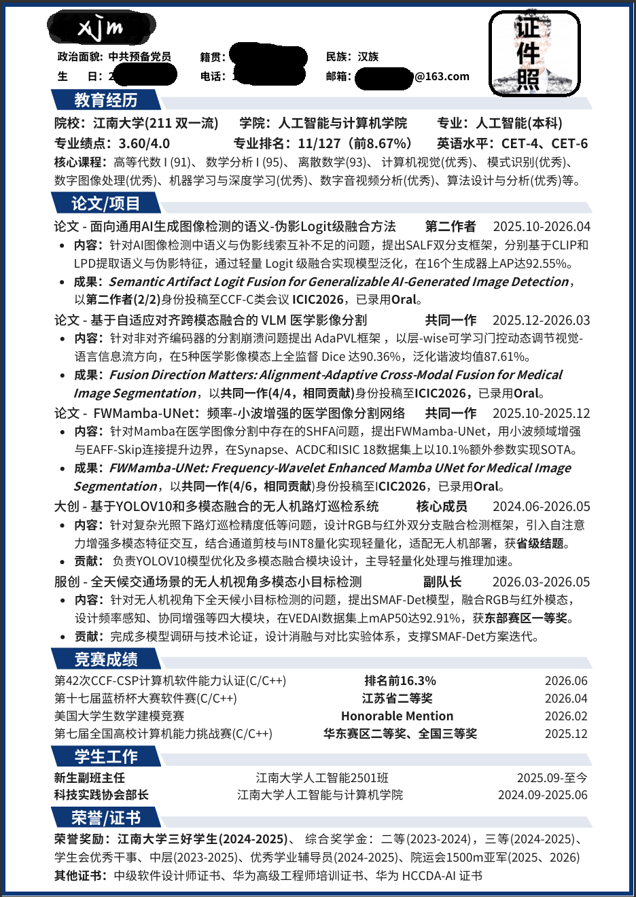
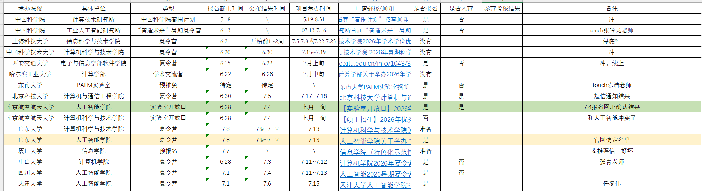
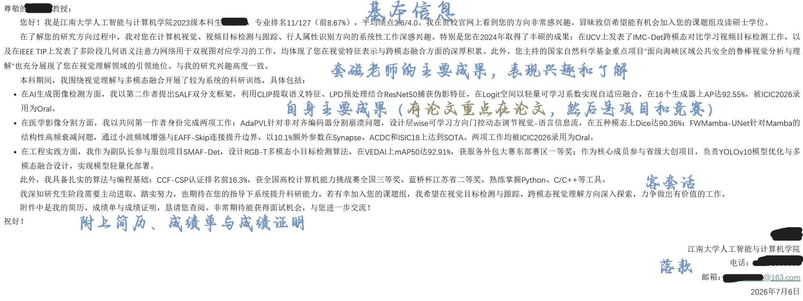
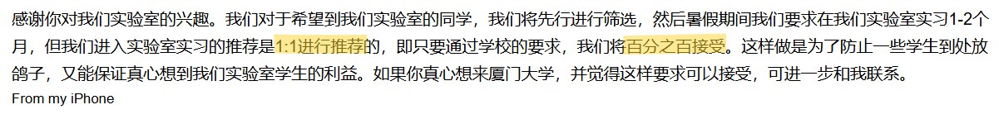
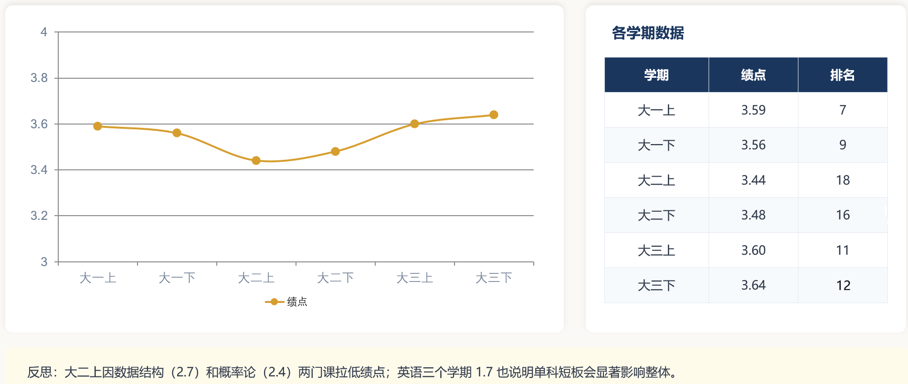

## 个人背景

| 项目 | 内容 |
| --- | --- |
| 本科专业 | 人工智能 |
| GPA | 前五学期 3.60；前六学期 3.64 |
| rk | 前五学期第 11 名；前六学期第 12 名 |
| 英语成绩 | CET-4 541；CET-6 437 |
| 荣誉 | 江南大学三好学生；江南大学二等综合奖学金； |
| 科研 | 三篇 CCF-C 类 oral 论文：二作、共一（4/4）、共一（4/6） |
| 竞赛 | 服创国二；计算机能力挑战赛个人国三；软件设计师证；CSP 前 16.3% |

简历：  

如果让我用一句话概括这段保研经历，那就是：保研不是大三下的百米冲刺，而是从大一就开始的马拉松。它需要绩点做地基，需要科研竞赛做台阶，也需要信息和选择做方向盘。

## 夏令营经历

| 院校 | 入营情况 | 考核结果 |
| --- | --- | --- |
| 厦门大学 | &#x2705; | 七推通过，最终去向 |
| 北京科技大学 | &#x2705; | 入营，因去厦大学习而未参加 |
| 南京理工大学 | &#x2705; | 入营，因去厦大学习而未参加 |
| 南京航空航天大学 | &#x2705; | 入营，原计划参加线下交流会，后因厦大面试放弃 |
| 四川大学 | &#x274c; | 未入营 |
| 天津大学 | &#x274c; | 未入营 |
| 中山大学 | &#x274c; | 未入营 |
| 东南大学 | &#x274c; | 未入营 |
| 山东大学 | &#x274c; | 未入营 |

具体的可以看下面这个表，我是用的Excel来记录自己夏令营的报名情况的，然后手机上也有一个便签工具来记录关键的时间节点：

（可以看到主播只更新到7月8号报名的，也就都是第一批的夏令营，而且也比较少，原因简单点说就是7月初就拿到铁offer了，后面会细说）

### 厦门大学（七推）

大三下我还有很多成果处于产出期，所以联系导师起步较晚，没有像一些同学从四五月份就开始广泛联系，而是到 6 月中旬才开始。我的策略是：报名了哪个学校的夏令营或预推免，就以此为契机联系一位老师；如果被拒绝，或老师三天内没有回复，再联系该校另一位老师。现在回看，这种策略也有局限，因为联系到的老师数量确实偏少。
我的套磁信模板：

7 月 7 日左右，我收到了厦大老师的回复邮件。老师对我比较满意，专门打来电话邀请我去厦大进行一对一面试。于是我放弃去南京参加南航线下交流会，转飞厦门。7 月 12 日沟通后，老师承诺保证一对一推荐：如果我来，他就把名额留给我，不再联系其他同学，也能保证我七推通过。  
导师回复：

面对这份诚意，我全力准备厦大七推，并拒绝了其他学校的面试和夏令营。7 月 18 日七推面试时，我被学院其他老师问住，我的老师还来帮我解围，问了一些简单问题后让我出去。最终我顺利通过七推。之后我没有再关注其他保研信息，8 月在厦大实验室学习了一个月；9 月拿到学校推免资格后，按照双方的承诺，我在系统中仅填了厦大，被接收后，我的推免到此结束。

这段经历让我感受很深：承诺很珍贵，兑现更重要；双向选择，往往比单方面追逐更让人安心。

### 其他入营院校与未入营复盘

截至 7 月初，我入营的院校是北科大、南理、南航、厦大。一开始我觉得比较有把握的四川大学、天津大学、东南大学、山东大学都没有入营。复盘下来，一是绩点不够突出，没有挤到前 5%；二是这些学校第一轮夏令营往往更严格，越往后到 8 月甚至 9 月，条件往往会宽松一些。

在确定厦大并得到老师承诺后，我拒绝了其他学校的面试和夏令营，因此北科大、南理、南航等入营院校后续没有继续参加。现在回看，这种做法风险不小，建议后来者结合自身把握和承诺可靠性谨慎选择。

## 最终去向

- 最终去向：厦门大学计算机科学与技术（081200）
- 选择原因：厦大老师在我七推准备阶段给了明确承诺和一对一推荐，沟通中展现出较大诚意；7 月面试通过后，我 8 月进入厦大实验室学习，双方承诺也得到兑现。对我来说，这是一次双向选择，而不是单方面决定。

## 复盘与建议

我的前三年的保研经历，除了大二出了点小问题，整体还算顺利。想对学弟学妹说的是：保研并非一朝一夕的事情，它需要长足准备。

第一，绩点是入场券。大一上我的绩点是 3.59，第 7 名；大一下 3.56，第 9 名。大二是我绩点波动最大的一年，一度掉到保研名额边缘，数据结构和概率论分别只拿到 2.7 和 2.4，英语又一直是我的短板，三个学期拿到 1.7。有几门低绩点的课程，是真的很吃亏，会把整体的绩点往后拖很多。好在问题暴露得不算太晚，大三还有把局面拉回来的机会。

GPA：

第二，科研竞赛是加分项。大三是我最忙的一年：一边稳绩点，一边推进论文和科研，同时还担任副班。最后除了参与三篇论文、拿到一个国二和一个国三外，为了保研加分，我还考了软件设计师证，CSP 拿到前 16.3% 的成绩，并把绩点提到 3.64，算是把边缘情况拉回到正常外保的平均水平。保研路上，努力很重要，但努力的方向同样重要：绩点、科研、竞赛、证书，都是在不同阶段为你加筹码。

第三，信息和选择决定你能走多远。我联系导师起步较晚，策略也比较保守。我了解到有同学从三月份开始累计发了 150 多封邮件，和十余名老师有联系，最后选择空间明显更广。套磁和择校时，既要主动，也要给自己留足备选。

第四，保研要早准备，但不要早焦虑。至少从大一打好坚实的绩点基础，大二大三积极产出科研和竞赛成果。大一的绩点未必决定一切，但它决定了你后面有没有从容试错的余地。早准备不是早焦虑，而是把主动权一点点拿回来。

此外，对于情况和我差不多的同学，其实可以尝试更多更高水平的院校，我这个纯粹是拿offer拿的太早了，所以没有关注更多的院校，我想，如果我八九月份继续征战夏令营的话，十分有可能去到更好的学校（有一个和我水平相当的同学去的中南，有一个20多名的同学去的电子科大）；但如果想要冲击上九的话，那么可能需要申请直博，或者考虑一些交叉方向，这样成果的概率会相对大一点。

最后分享一个好消息和一个提醒。好消息是，保研名额确实有了一定扩充，今年甚至有 3.0 出头的同学拿到了保本校的资格。但也要注意，下一届保研系统时间提前到了七月份，这意味着很多学校没有时间举办自己的夏令营和预推免，并且好像是只考虑前5个学期的绩点，下一届保研注定和这一届有很大区别，值得大家持续关注并提前考虑。

愿你们早一点出发，也稳一点抵达。

欢迎任何有保研意向的同学联系我，或者愿意来厦大的同学，我非常非常愿意提供咨询和我力所能及的帮助。微信:xjm15138503650；QQ:2656601238（加好友注意说明来意和备注）
